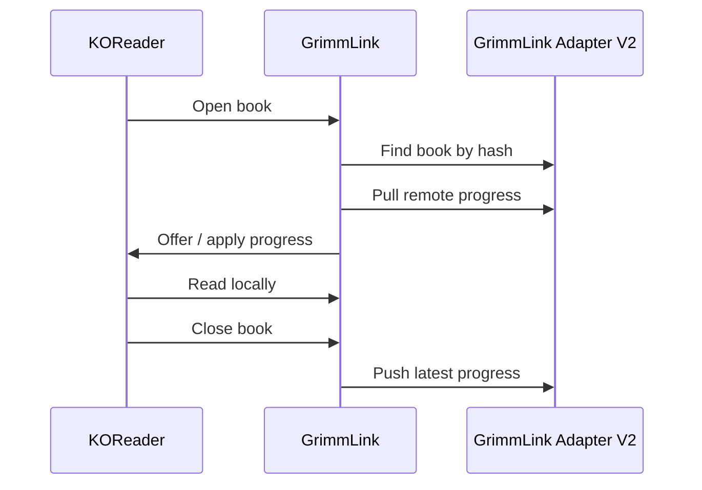
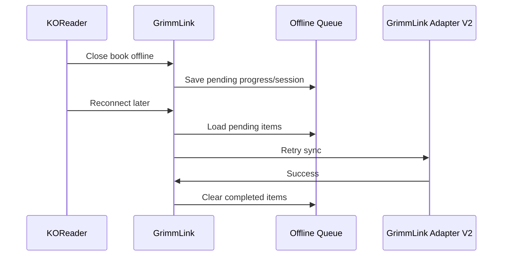
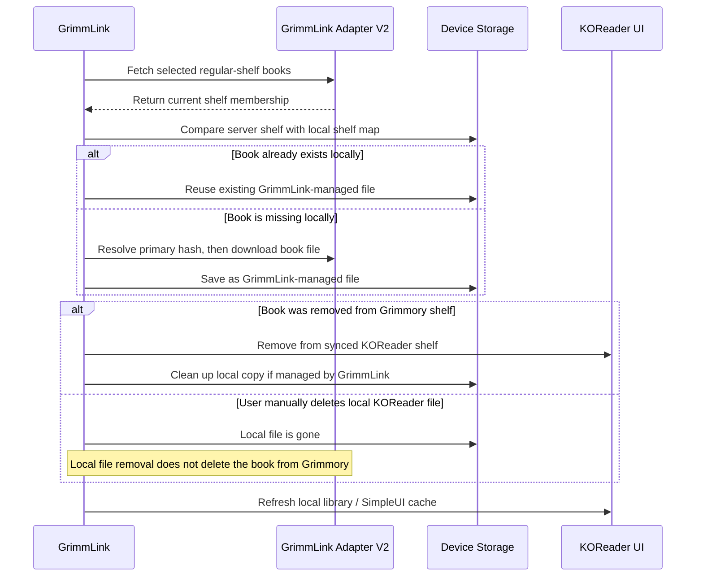

<h1 align="center">📚 GrimmLink</h1>

<h3 align="center">✨ KOReader companion for GrimmLink Adapter V2</h3>

<p align="center">
  <strong>🔄 Sync reading progress, ⏱️ sessions, 🗂️ regular shelves, 📝 metadata, and 📥 downloaded books through <a href="https://github.com/0xstillb/grimmlink-adapter">GrimmLink Adapter V2</a>.</strong>
</p>

<p align="center">
  
  
  
  
</p>

<p align="center">
  <a href="#features">✨ Features</a> ·
  <a href="#installation">🚀 Installation</a> ·
  <a href="#configuration">⚙️ Configuration</a> ·
  <a href="#how-it-works">🔄 How It Works</a> ·
  <a href="#development">🛠️ Development</a> ·
  <a href="#roadmap">🧭 Roadmap</a>
</p>

<p align="center">
  <strong>📍 Progress Sync</strong> ·
  <strong>🗂️ Regular Shelf Sync</strong> ·
  <strong>📦 Offline Queue</strong> ·
  <strong>🧰 Diagnostics</strong>
</p>

---

> ✅ **GitHub-ready:** this README intentionally uses Unicode emoji in headings, navigation, feature cards, notes, and flow sections for a more polished project landing page.

## 👋 What is GrimmLink?

**GrimmLink** is a KOReader plugin that connects to [GrimmLink Adapter V2](https://github.com/0xstillb/grimmlink-adapter), which works with the official upstream [Grimmory project](https://github.com/grimmory-tools/grimmory). The plugin does not require the former `0xstillb/grimmory` fork or its custom GrimmLink API endpoints.

The Adapter is the bridge between KOReader and Grimmory: it authenticates the linked KOSync account, translates the plugin's Adapter V2 requests to Grimmory's supported APIs, and returns the data in the format the plugin expects. Configure GrimmLink with the Adapter URL; configure the Adapter with your Grimmory server and linked KOSync account.

```text
KOReader + GrimmLink  ⇄  GrimmLink Adapter V2  ⇄  Official Grimmory upstream
```

Reading progress, sessions, supported shelves, downloaded books, and selected metadata can then move between your e-reader and Grimmory.

Open a book in KOReader. Read offline. Close the book. Reconnect later. GrimmLink quietly handles the sync work in the background.

> 💡 GrimmLink is designed for real e-reader usage: unstable Wi-Fi, long reading sessions, large libraries, local servers, remote servers, and devices that are not always online.

---

## 🎯 Why GrimmLink?

Most reading sync tools solve only one part of the problem: progress.

GrimmLink aims to become the full KOReader companion layer for Grimmory:

- 📍 **Progress sync** for KOReader-native reading positions
- ⏱️ **Reading session sync** for reading history and stats
- 🗂️ **Shelf sync** for selected Grimmory shelves
- 🪄 **Magic Shelf support** is planned for an Adapter capability that provides these collections
- 📦 **Offline queue** for unreliable network conditions
- 📥 **Local book downloads** through the Adapter's verified hash route
- 📝 **Metadata sync** for ratings, annotations, and bookmarks
- 🧰 **Diagnostics and backup tools** for real-world debugging

---

<a id="features"></a>

## ✨ Features

### 📍 Reading Progress Sync

GrimmLink can push and pull reading progress between KOReader and Grimmory.

| Capability | Status |
|---|---:|
| Pull progress when opening a book | ✅ |
| Push progress when closing a book | ✅ |
| Manual push / pull | ✅ |
| Conflict handling | ✅ |
| Fixed-page format support | ✅ |
| Reflowable format support | ✅ |
| Offline progress queue | ✅ |

Supported fixed-page formats include:

```text
PDF, CBZ, CBR, CB7, DJVU
```

Supported reflowable formats include:

```text
EPUB, MOBI, AZW, AZW3, FB2, HTML, TXT, DOCX
```

---

### ⏱️ Reading Sessions

GrimmLink tracks reading activity and sends reading sessions to Grimmory.

It supports:

- 🟢 session start / end tracking
- ⏳ duration calculation
- 📊 start and end progress
- 🧮 minimum session duration threshold
- 📦 batch upload for pending sessions
- 🕰️ historical import from KOReader statistics data

This allows Grimmory to understand not only **where** you are in a book, but also **how** you read.

---

### 🗂️ Shelf Sync

Bring selected Grimmory shelves into KOReader.

Adapter V2 currently supports regular shelves. The Magic Shelf menu remains visible but its sync call returns an explicit unsupported result.

| Shelf Feature | Status |
|---|---:|
| Regular shelf sync | ✅ |
| Magic shelf sync | Not available in Adapter V2 |
| Regular + Magic sync | Not available in Adapter V2 |
| Download books from Grimmory | ✅ |
| Reuse existing downloaded files | ✅ |
| Fast sync cache | ✅ |
| Cancel long sync jobs | ✅ |
| Free-space safety checks | ✅ |
| Local cleanup for removed shelf books | ✅ |
| Async → blocking download fallback | ✅ |
| Batched pending-removal drain for large shelves | ✅ |
| SimpleUI bookinfo refresh | ✅ |

Shelf sync is designed to keep Grimmory as the source of truth while making selected books available locally on the device.

---

### 🗑️ Safe Delete Policy

GrimmLink is intentionally conservative with deletion.

| Action | Result |
|---|---|
| 🗂️ Book removed from a Grimmory shelf | Removed from the synced KOReader shelf on the next sync |
| 🧹 Local cleanup after shelf removal | Removes only GrimmLink-managed local copies inside managed download roots |
| 🚫 Delete from Grimmory library | Not performed by GrimmLink |
| 🚫 Delete arbitrary user files | Not performed by GrimmLink |
| ⚠️ User manually deletes/removes a local KOReader file | Not documented as guaranteed server-side shelf removal unless the device hook is implemented and tested |

> ⚠️ Local-delete → Grimmory shelf removal is not guaranteed. The plugin does not delete books from the Grimmory library.

---

### 📦 Offline Queue

E-readers are not always online. GrimmLink expects that.

When the network is unavailable, GrimmLink can queue:

- 📍 progress updates
- ⏱️ reading sessions
- 📝 metadata changes
- 🗂️ supported shelf-removal API retries

Pending sync replays these queues in smaller follow-up rounds after resume or reconnect, and a failure in one queue no longer prevents the others from retrying.

Pending items can be retried later when the device reconnects.

---

### 📝 Metadata Sync

GrimmLink includes a metadata sync layer for richer reading data.

Supported metadata areas:

- ⭐ ratings
- ✍️ annotations
- 🔖 bookmarks

Metadata sync can be enabled separately from core progress and shelf sync.
`Pull Remote Metadata Now` resolves the open/current book, applies supported
items without duplicating local annotations or bookmarks, and reports why any
unsupported or disabled items were skipped. Manual pulls run in the background
and show connecting, receiving, and applying stages so slow network requests do
not block the KOReader interface.

---

### 🌐 Local + Remote Server URLs

GrimmLink supports both a local Adapter V2 URL and a remote Adapter V2 URL.

Typical setup:

```text
Local URL  → http://192.168.x.x:8085
Remote URL → https://your-domain.example.com
```

This is useful when the Adapter is hosted at home and also available through a reverse proxy or tunnel.

> 📡 Note: KOReader does not reliably expose Wi-Fi SSID information across all devices. `home_ssid` should be treated as an optional note / diagnostic hint, not as a reliable automatic routing mechanism.

---

### 🧰 Diagnostics, Backup, and Maintenance

GrimmLink includes maintenance tools for development and real-device testing:

- 🔌 connection diagnostics
- 💾 local settings backup
- 🧪 diagnostics bundle export
- 🐞 debug logging
- 📄 file logging
- 📦 pending queue inspection
- 🕰️ historical reading session import
- ⬆️ update checks

These tools are especially useful when testing on Android-based e-readers, iReader devices, Kobo devices, or desktop KOReader builds.

---

<a id="installation"></a>

## 🚀 Installation

### 1. 📥 Download the plugin

Download the latest `grimmlink.koplugin.zip` from the release page.

### 2. 📂 Extract the plugin

After extraction, the folder should look like this:

```text
grimmlink.koplugin/
├── main.lua
├── _meta.lua
├── plugin_version.lua
├── grimmlink_api_client.lua
├── grimmlink_database.lua
├── grimmlink_shelf_sync.lua
└── ...
```

### 3. 📲 Copy to KOReader plugins folder

Copy the entire folder into KOReader's `plugins` directory.

Common paths:

```text
Android:
/sdcard/koreader/plugins/grimmlink.koplugin

Kobo:
.adds/koreader/plugins/grimmlink.koplugin

Linux desktop:
~/.config/koreader/plugins/grimmlink.koplugin
```

### 4. 🔄 Restart KOReader

Restart KOReader completely.

Then open:

```text
KOReader → Tools / Plugins → GrimmLink
```

---

<a id="configuration"></a>

## ⚙️ Configuration

Open the GrimmLink settings menu and configure the connection to your GrimmLink Adapter V2 server.

> 🔗 Deploy Adapter V2 and link the KOSync account to a Grimmory account before connecting the plugin.

### 🔐 Required settings

| Setting | Description |
|---|---|
| Server URL / Local URL | Your Adapter V2 base URL, such as `http://grimmlink.local:8085` |
| Username | KOSync username configured in Grimmory |
| KOSync password | Plain KOSync password configured in Grimmory; the plugin computes its MD5 key. Re-enter it if an older setup stored a digest. |
| Device name | Display name for this KOReader device |

### ✅ Recommended settings

| Setting | Recommended |
|---|---:|
| Auto pull on open | Enabled |
| Auto push on close | Enabled |
| Offline queue | Enabled |
| Ask before Wi-Fi sync | Enabled for e-readers |
| Shelf fast sync | Enabled |
| Refresh SimpleUI bookinfo after shelf sync | Enabled if using SimpleUI |

### 🗂️ Optional shelf settings

| Setting | Description |
|---|---|
| Regular shelf sync | Sync one selected Grimmory shelf |
| Magic shelf sync | Unavailable with Adapter V2 |
| Separate Magic download directory | Reserved for future Magic Shelf support |
| Use original filename | Keep server-provided filenames when possible |
| Two-way shelf delete sync | Experimental / implementation-dependent; do not rely on local-delete → server shelf removal unless verified on device |

---

<a id="how-it-works"></a>

## 🔄 How It Works

### 📍 Progress flow



### 📦 Offline flow



### 🗂️ Shelf sync flow



Shelf deletion is scoped to **shelf membership** and **GrimmLink-managed local files**. GrimmLink does not delete books from the Grimmory library and does not delete arbitrary user files outside its managed download roots.

---

## 🧩 Adapter V2 API Usage

GrimmLink communicates with **[GrimmLink Adapter V2](https://github.com/0xstillb/grimmlink-adapter)**. The Adapter communicates with stock Grimmory.

Core endpoint groups include:

```text
/api/grimmlink/v2/auth/session
/api/grimmlink/v2/books/resolve?hash={hash}
/api/grimmlink/v2/progress/{hash}?reader=koreader
/api/grimmlink/v2/progress/{hash}
/api/grimmlink/v2/reading-sessions[/batch]
/api/grimmlink/v2/syncs/metadata[/batch]
/api/grimmlink/v2/shelves
/api/grimmlink/v2/shelves/{shelfId}/items
/api/grimmlink/v2/shelves/{shelfId}/items/{bookId}
/api/grimmlink/v2/books/{bookId}/hash
/api/grimmlink/v2/books/{bookId}/content?hash={hash}
/api/grimmlink/v2/books/read-statuses
/api/grimmlink/v2/books/{bookId}/status
```

The plugin sends the KOSync username and MD5 key only to `POST /auth/session`. It uses the returned bearer token for subsequent V2 requests. An expired session is renewed after a 401 response. Shelf downloads first resolve a verified primary-file hash when the shelf item does not include one.

```text
x-auth-user: <KOSync username>
x-auth-key: <MD5 of KOSync password>
```

---

## 🧱 Project Structure

```text
grimmlink.koplugin/
├── main.lua                               # KOReader plugin entry point
├── _meta.lua                              # KOReader plugin metadata
├── plugin_version.lua                     # Version/build metadata
├── grimmlink_api_client.lua               # Grimmory API client
├── grimmlink_connection_controller.lua    # Connection setup and tests
├── grimmlink_constants.lua                # Defaults and shared constants
├── grimmlink_database.lua                 # Local SQLite storage and queues
├── grimmlink_diagnostics_controller.lua   # Diagnostics, backup, debugging
├── grimmlink_lifecycle_controller.lua     # Open/close/resume lifecycle hooks
├── grimmlink_magic_shelf_controller.lua   # Magic Shelf UI/controller
├── grimmlink_menu_builder.lua             # Settings/menu UI
├── grimmlink_metadata_controller.lua      # Metadata sync orchestration
├── grimmlink_metadata_extractor.lua       # KOReader metadata extraction
├── grimmlink_pending_sync.lua             # Pending queue sync engine
├── grimmlink_progress_controller.lua      # Progress sync logic
├── grimmlink_session_controller.lua       # Reading session tracking
├── grimmlink_shelf_controller.lua         # Shelf controller/UI actions
├── grimmlink_shelf_sync.lua               # Shelf sync planning/download/cleanup
├── grimmlink_updater.lua                  # Release/update checker
├── grimmlink_util.lua                     # Shared helpers
└── test/                                  # Test suite
```

---

<a id="development"></a>

## 🛠️ Development

### 🧪 Run tests

This project includes Lua test specs under `test/`.

Typical command:

```bash
busted test
```

Useful test areas:

```text
test/api_client_spec.lua
test/grimmlink_database_spec.lua
test/grimmlink_deletion_spec.lua
test/grimmlink_matching_spec.lua
test/grimmlink_metadata_extractor_spec.lua
test/grimmlink_pending_sync_spec.lua
test/grimmlink_progress_sync_spec.lua
test/shelf_sync_spec.lua
test/updater_spec.lua
```

### 📱 Real-device testing checklist

Before tagging a stable release, test on at least one real KOReader device:

- ✅ install plugin from a clean KOReader profile
- ✅ connect to GrimmLink Adapter V2 backed by stock Grimmory
- ✅ authenticate successfully
- ✅ open a matched book
- ✅ pull remote progress
- ✅ read and push local progress
- ✅ read offline and confirm queue retry
- ✅ sync a small shelf
- ✅ sync a large shelf
- ✅ cancel a long shelf sync
- ✅ remove a book from a Grimmory shelf and verify local cleanup
- ✅ verify local/manual delete behavior before documenting it as two-way delete
- ✅ confirm server library files are not deleted
- ✅ restart KOReader and verify state is preserved

---

<a id="roadmap"></a>

## 🧭 Roadmap

GrimmLink is actively evolving. Current focus areas:

- 🔁 improve stale-file detection when server book files change
- 📝 expand metadata sync reliability across formats
- 🔐 polish diagnostics and credential redaction
- 🚀 refine release/update workflow

Recently completed stability work:

- ✅ harden large shelf sync on low-power e-readers
- ✅ improve async download behavior across Android/e-ink devices
- ✅ strengthen pending queue handling for edge cases

---

## ⚠️ Known Notes

- 📡 KOReader may not expose Wi-Fi SSID reliably on every device, so network routing should not depend on SSID detection.
- 🧰 Some devices may not include `curl` or `wget`; download behavior should be tested on target hardware.
- 🗂️ Large shelves should be tested on real devices, not only desktop KOReader.
- 📝 Metadata and annotation behavior can vary by book format.
- 🗑️ Local-delete → Grimmory shelf removal should not be advertised as guaranteed until verified with an active KOReader hook and real-device testing.

---

## 🏷️ Version

```text
Version: v2.0.0
Type: release
Commit: 99949d6
Build: 2026-06-15T23:45:00+07:00
```

---

## 📜 License

Add your project license here.

Recommended options:

- MIT for maximum openness
- GPL-compatible license if you want stronger copyleft alignment
- Project-specific license if Grimmory integration requires one

---

<div align="center">

**📚 GrimmLink**  
_Read in KOReader. Sync with Grimmory. Keep your library moving._

</div>
